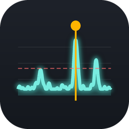

# RF Technical Monitor

*Anciennement « TinySA Monitor » (jusqu'à la 8.0). Compatible tinySA Ultra et SDR ; projet indépendant, sans lien avec
les fabricants.*

Application Windows (Python / PySide6) pour **analyser le spectre** et **surveiller en continu 100+ fréquences**
avec un **tinySA Ultra** — et, depuis la **version 8**, avec un **SDR** (HackRF, SDRplay, RTL-SDR, Airspy, WiNRADiO…)
pour **écouter** les micros analogiques en plus de les surveiller (fonctions SDR en **bêta**). Pensée pour la
coordination HF en festival, sonorisation et événementiel.

> Les attributions de bandes (police, aéro, 4G/5G, TNT, micros HF…) sont **indicatives** : vérifie toujours la
> réglementation locale avant d'émettre.

📖 **Manuel d'utilisation complet** : [`docs/manuel.pdf`](docs/manuel.pdf) (PDF, lisible ici sur GitHub) · [`docs/manuel.html`](docs/manuel.html) (aussi dans l'appli : ☰ Plus › 📖 Manuel).

🌐 **English** : the whole app is available in English (☰ Plus › 🌐 Langue / Language, or automatically on an
English Windows). User manual: [`docs/manual_en.pdf`](docs/manual_en.pdf) (PDF) · [`docs/manual_en.html`](docs/manual_en.html).

## Nouveau en version 8

- **📡 SDR (bêta)** : un tinySA mesure seulement la puissance ; un SDR reçoit le signal lui-même et le **démodule** :
  tu **entends** un micro analogique (FM, compander deviné d'après l'appareil du plan, modifiable), tu vois son
  spectre fin et son waterfall. Mode **📟 tinySA**, **📡 SDR** ou **combiné** (bouton en haut). Favoris au **pavé
  numérique**, **patrouille**, **calage tout seul sur une alarme** (avec enregistrement), **pilote** retenu par micro,
  **⏪ remonter le temps** (réécouter les dernières minutes), assistant de premier branchement, calage des niveaux sur
  le tinySA, plusieurs SDR (un par scène), récepteurs Shure / Sennheiser en réseau.
- **🧪 SDR démo** (sans matériel, avec du son) et **mode démo du tinySA** : ils fabriquent **toutes tes fréquences**
  (plus un brouilleur, des coupures, la TNT) pour voir et écouter ta liste avant le show. **🎵 Générateur audio**
  (tonalité, balayage 20 Hz – 20 kHz, bruit, WAV) : à écouter, ou à **affecter** à un micro des démos, à un son
  d'alarme ou à l'émission.
- **📡 Émission avec un HackRF** (en câble, pour tester un récepteur) : faux micros FM avec son et pilote.
- **📡 Micros suivis par le SDR** : choisis-les dans « Mes fréquences » (Ctrl+Maj+F, ou clic droit › 📡).
- **🖥 Plusieurs écrans** : tinySA complet sur un écran, SDR complet sur l'autre, ou ton mélange panneau par
  panneau ; la répartition revient au lancement suivant.
- **Sons d'alarme** en carillons doux (les anciens bips restent au choix), sons personnalisables ; l'appli ne s'ouvre
  plus deux fois (la relancer ramène la fenêtre déjà ouverte).

## Ce que ça fait

- **Spectre en direct** multi-bandes, max hold, waterfall, zoom, courbe de référence (bruit de fond du lieu)
- **Liste de fréquences** (nom, statut, seuil propre à chaque fréquence, taux d'occupation 10 min → 12 h)
- **Couches Scènes › Groupes** : un clic = on ne surveille / ne scanne que le groupe voulu ; bouton Global pour tout voir
- **Statuts** : « doit rester libre » (⚠ CONFLIT si un signal apparaît) et « doit émettre » (⚠ ABSENT si un TX se tait)
- **Alarmes** : panneau dédié, acquittement, priorité par groupe (Critique ❗ = son répété jusqu'à acquittement)
- **Intermodulation** 2 / 3 / 5 TX (ordres 3, 5, 7), tolérances par type de produit (2 TX 100 kHz,
  3 TX 50 kHz par défaut), et « d'où ça peut venir ? » pour un signal inconnu
- **🔁 Convertisseur de scans** : WSM, WWB ou CSV au choix (colonnes, unités, séparateur), en entrée comme en sortie
- **🩺 Diagnostic tinySA** : fichier avec les derniers échanges avec le tinySA, à envoyer en cas de bug
- **🧮 Vérifier le plan de fréquences** (Outils, coordination basique) : écart entre porteuses et intermod selon tes
  tolérances, filtre du récepteur et pas, avec un **profil d'appareil par fréquence** (Wisycom très sélectif,
  Shure, Sennheiser, ears…), ✔ / ✗ par fréquence avec le
  détail, et une fréquence de remplacement compatible en un clic
- **🎤 Appel des micros** (Ctrl+L) : allume tes émetteurs, chaque fréquence passe ✓ ; résumé au journal, pack mal
  réglé repéré (signal inconnu tout près d'une fréquence qui manque)
- **Page web** pour l'équipe, façon Ontime : une adresse, plusieurs vues (liste, mur, spectre en direct, waterfall,
  alarmes). Le PC choisit les vues partagées, peut mettre un mot de passe, voit qui est connecté ; acquittement
  depuis le téléphone avec un code PIN
- **Statut au clavier** : sélectionne des fréquences, **Ctrl+E** = En service, Ctrl+1…9 = statut n° 1…9, Ctrl+0 = aucun
- **Alertes téléphone** : tuto pas à pas (ntfy / Telegram) dans la fenêtre Alertes, chat id Telegram trouvé tout seul
- **Fréquence de secours** : canaux libres d'après le spectre mesuré, sans intermod avec ta liste
- **Nommage rapide** (MIC 1, HF 1, IEM 1, Intercom… avec numérotation automatique +1)
- **Enregistrement des balayages + relecture** (curseur de temps, lecture accélérée, saut à un événement)
- **Rapport de fin de show** (HTML autonome, imprimable en PDF)
- **Scans WSM / WWB** : import d'un scan comme référence, conversion WSM → WWB, export du scan au format WWB
- **Export des fréquences** par scène / par groupe
- **Fenêtres libres** : panneaux déplaçables / détachables (double écran), mur de fréquences plein écran
- **Jusqu'à 8 tinySA** en parallèle, sur le même PC ou par le réseau (relais intégré, kit Raspberry Pi), avec bascule
  automatique, noms de position, calibration et « diversity » (meilleure mesure des deux)
- **Alertes sur téléphone** (ntfy / Telegram) et **page web** en lecture seule pour l'équipe
- Guide des bandes 100 kHz – 5,9 GHz par pays, canaux TV, journal CSV automatique
- **🎪 Shows** : un show s'enregistre et se rappelle d'une année à l'autre (fréquences, scènes, référence du lieu…)

## Installer

### Option 1 — l'exe prêt à l'emploi
Page **Releases** du dépôt : `RF-Technical-Monitor.exe` dans la dernière version (stable, publiée à chaque nouvelle version
sur `main`) ou dans la pré-release « Test … » (dernière version de test, remplacée à chaque push de la branche).
Lien direct vers la dernière version stable :
`https://github.com/leturboc/RF-Technical-Monitor/releases/latest/download/RF-Technical-Monitor.exe`

### Option 2 — le compiler toi-même
Double-clique sur `build.bat` (installe Python via winget si besoin, puis crée `dist\RF-Technical-Monitor.exe`).

### Option 3 — lancer depuis Python
```
pip install -r requirements.txt
python tinysa_monitor.py
```
Python 3.12 ou 3.13 conseillé.

## Deux tinySA (USB ou réseau)

Deux tinySA balayent en parallèle : le cycle est environ deux fois plus court, et **si l'un décroche, l'autre
reprend toutes les bandes** (alarme critique ⚠ APPAREIL, nouvel essai de connexion toutes les 5 s).

1. **Réglages › 2ᵉ tinySA** : coche « Utiliser un 2ᵉ tinySA » et donne son adresse.
   - branché sur le même PC : son port (`COM4`) ;
   - branché sur **un autre PC** : sur ce PC-là, lance `RF-Technical-Monitor.exe --relais` (ou 🔧 Outils › 📡 Relais
     réseau), choisis le port du tinySA et clique « Partager ». La fenêtre affiche l'adresse à saisir sur le PC
     principal, par ex. `192.168.1.20:5025`. Windows demande d'autoriser l'accès réseau : accepte (réseau privé).
     Un pont série-TCP en mode brut (ser2net, Raspberry Pi…) marche aussi.
2. Table des **bandes**, colonne « tinySA » (double-clic) : **Auto** (répartition équilibrée), **1** ou **2**.
   Une seule grosse bande ne se partage pas : **✂ Couper** la divise en deux moitiés.
3. **Noms de position** (« Plateau », « FOH »…) : repris dans les alarmes et le journal (« vu par FOH »), pour
   savoir quelle antenne a vu le signal.
4. **Offset** du 2ᵉ : correction en dB si les deux appareils ne lisent pas pareil, ou **⚖ Calibrer le 2ᵉ sur le 1er**
   (les deux reçoivent le même signal, même antenne via un splitter : ~20 s et l'offset est réglé tout seul).

Pendant le zoom live, un tinySA zoome et l'autre continue de surveiller toutes les bandes. En réseau, préfère un câble au Wi-Fi ; une liaison qui se tait
(câble arraché) est détectée après ~30 s au réglage par défaut (plus long avec un RBW très étroit).

## 🎪 Shows : rappeler un événement d'une année à l'autre

Bouton **🎪 Shows** (en haut) :
- **Enregistrer le show** (Ctrl+S) : fréquences (et blocs Spectera), scènes / groupes / priorités, statuts, bandes,
  seuils, réglages de mesure, pays et plan, noms de position des tinySA, **courbe de référence du lieu** (bruit de
  fond mesuré), plus les infos : nom, lieu / scène, dates, notes.
- **Ouvrir un show** : liste des shows (nom, lieu, dates, nombre de fréquences, référence ✔) avec leurs notes.
  **Enregistrer sous…** pour l'édition de l'année suivante ou une autre scène. **Récents** dans le menu.
- Un show **ne contient pas tes préférences** (couleurs, fenêtres, repères, alertes, page web, adresse du 2ᵉ tinySA,
  dossier des journaux) : rouvrir le show de l'an dernier ne dérègle pas ton installation.
- Fichiers `.tsashow` dans `Documents\RF Technical Monitor\Shows` (à sauvegarder / copier sur clé). Les anciens profils
  `.json` s'ouvrent aussi (seule leur partie « show » est reprise).

## Repères du spectre : choisir ce qu'on affiche

Bouton **📍 Repères** (au-dessus du spectre) :
- par **état mesuré** (occupées, faibles, libres, sans mesure), par **scène › groupe**, par **statut** ;
- **fréquence par fréquence** : clic droit dans la liste › « Masquer le repère sur le spectre » ;
- « Toujours montrer les fréquences en alarme » (coché par défaut : un filtre ne cache jamais une alarme) ;
- noms, signaux inconnus, style **trait plein** ou **petit repère discret en haut**, couleur (état / statut / groupe) ;
- **Ctrl+M** masque / réaffiche tout d'un coup ; « Tout afficher » enlève les filtres.

## Sennheiser Spectera (WMAS) et autres porteurs larges

Spectera émet un **porteur large de 6 ou 8 MHz** (un canal TV) au lieu d'une fréquence par micro : on le surveille
comme un **bloc**.
- 🔧 Outils › **📶 Ajouter un bloc Spectera / WMAS** : choisis le canal TV (selon le pays) ou une fréquence centrale +
  largeur. Ou, sur une fréquence existante : clic droit › « Bloc large ».
- « Doit émettre » : on regarde le **niveau médian** du bloc (le porteur est-il là ?) → ⚠ ABSENT s'il disparaît.
  « Doit rester libre » : on regarde le **pic** dans le bloc → ⚠ CONFLIT au moindre signal.
- Sur le spectre, un bloc est dessiné par ses deux bords et une barre. Une fréquence qui tombe **dans** un bloc est
  signalée dans la liste (« ⚠ dans le bloc … »).
- Préréglages de bandes : Spectera UHF 470–608 / 630–698 MHz et 1G4 1350–1400 / 1435–1525 MHz (selon les pays).
- Le mode démo simule un porteur Spectera pour les blocs « Doit émettre ».

L'intermodulation tient compte de la largeur des blocs : leurs produits sont des bandes (« 540.000 ± 8.0 »).

## Alertes sur téléphone et page web

🔧 Outils › **📣 Alertes téléphone et page web** :

- **Alertes push** (critiques seulement, ou critiques + normales) via **ntfy** (appli gratuite iOS / Android, sans
  compte : on s'abonne au nom de canal affiché) ou **Telegram** (bot créé avec @BotFather). Il faut Internet
  (4G, wifi du site). Bouton « Envoyer une alerte de test ». Un tinySA perdu / retrouvé est aussi signalé.
- **Page web en lecture seule** sur le réseau local : le régisseur ouvre l'adresse affichée
  (`http://192.168.x.x:8080`) sur son téléphone et voit les fréquences et alarmes, filtrées par scène / groupe,
  rafraîchies toutes les 2 s. Sans mot de passe : à n'activer que sur un réseau de confiance.

Le jeton Telegram reste dans la config de ce PC : il n'est pas copié dans les fichiers de show.

## Lire la colonne « Signal »

Le sens dépend du **statut** de la fréquence :

| Statut | Signal présent | Pas de signal |
|---|---|---|
| Doit émettre (En service…) | **OK** (vert), « OK (faible) » (orange) | « muet » (orange), puis **⚠ ABSENT** (rouge) |
| Doit rester libre | **⚠ CONFLIT** (rouge) | **✔ libre** (vert) |
| Sans statut | **OCCUPÉ** (rouge : pas de place ici) | libre (vert) |

Même code couleur sur le mur, les repères du spectre et la page web.

- **Tes mots** : ☰ Plus › 🔤 Mots affichés — remplace OK, ABSENT, CONFLIT, libre… par ce que tu veux.
- **INTERMOD** : quand un signal apparaît sur une fréquence « doit rester libre » et qu'il correspond à un produit
  d'intermodulation (ordre 3 ou 5) de tes émetteurs qui émettent, il est affiché INTERMOD au lieu de CONFLIT, avec la
  formule dans l'alarme et le journal (ex. « IM3 : 2×HF 1 − HF 3 »).
- **Unité des niveaux** (Réglages › Détection) : dBm, dBµV (50 Ω, = dBm + 107) ou % façon WSM (0 % = −120 dBm,
  100 % = 0 dBm) : seuils, liste, mur, axe du spectre, alarmes, page web. Les fichiers restent en dBm.

**Alerte « trop fort »** (Réglages › Détection) : un signal au-dessus du seuil (−25 dBm par défaut, ligne violette
sur le spectre) déclenche ⚠ TROP FORT — talkie collé à l'antenne, burst, émetteur trop près : risque de saturation
et de décrochage des récepteurs. Le tinySA lui-même sature vers −10 dBm.

## Interface : mode simple / expert, panneaux libres

- En haut : **🎪 Shows**, **🔔 alarmes**, les menus du travail **📋 Préparer**, **🎚 Surveiller**, **📊 Analyser**,
  **🔌 Matériel**, **🔎** chercher une fonction (Ctrl+K), le **mode** (📟 tinySA / 📡 SDR / combiné), **☰ Plus** et
  **⚙ Réglages**. Dessous, l'**accueil** en 3 cartes : ① le tinySA, ② mes micros, ③ surveiller.
- **Mode simple** (par défaut) : seuls les réglages utiles pendant le show sont affichés (seuils occupé / faible,
  TX absent, alerte, bandes, 2ᵉ tinySA, pays). **☰ Plus › Mode expert** (ou le bouton en haut des réglages) montre
  aussi RBW, entrée, LNA, atténuateur, offset, segments, fenêtre, seuil sur référence, calibration, relais…
- Les réglages sont en **sections repliables** (clic sur le titre) ; l'état est mémorisé.
- **Info-bulles** sur chaque bouton, case et liste (et dans les menus) ; l'explication s'affiche aussi en bas de la
  fenêtre au survol.
- Le **mur de fréquences** est un panneau (en onglet à côté du spectre) ; F11 le met en plein écran dans sa propre
  fenêtre (Échap pour le ramener). **📋 Choisir…** sur le mur (ou clic droit sur une tuile, ou dans la liste) :
  quelles fréquences ont une tuile ; « Alarmes toujours visibles » ramène une fréquence retirée tant qu'elle est en
  alarme. Le choix est gardé dans les shows. **Taille des tuiles** : Auto (elles remplissent le panneau) ou
  Petites / Moyennes / Grandes (taille fixe, on fait défiler). **🗗 Détacher** : le mur passe dans sa propre petite
  fenêtre, tu choisis sa taille à la souris (les tuiles suivent) ; **📌 Raccrocher** le remet à côté du spectre.
- **Tous les panneaux sont détachables**, y compris le **spectre** : attrape un panneau par sa barre de titre pour
  le déplacer, le mettre sur l'autre écran ou le ré-accrocher ; ☰ Plus › Fenêtres pour les réafficher.
- **Vraies fenêtres / double écran** (☰ Plus › 🪟 Fenêtres › 🗗) : chaque panneau (spectre, waterfall, liste,
  alarmes…) dans une vraie fenêtre Windows, agrandie ou plein écran sur l'écran choisi, rouverte au même endroit au
  prochain lancement ; fermer la fenêtre la raccroche.
- **🖥 Plusieurs écrans** (menu du mode, ou 🪟 Fenêtres) : pour chaque panneau, l'écran où il va ; chaque autre écran
  reçoit une fenêtre complète (panneaux côte à côte ou en onglets). Préréglages « tinySA ici · SDR sur l'autre »,
  l'inverse, « liste sur l'autre ». 👋 Identifier les écrans.

## Démarrage rapide

1. Branche le tinySA Ultra en USB, choisis le port (ou coche **Démo** pour essayer sans matériel : il fabrique les
   signaux de tes fréquences), **▶ Démarrer**. Un SDR ? Bouton du mode en haut › 📡, puis « 🔌 Premier branchement ».
2. Importe tes fréquences (📥 Importer CSV : plan EazyRF (.ezrf3), WWB, Excel…) ou saisis-les, range-les en
   Scènes › Groupes.
3. Donne un statut à chaque fréquence : *Libre* (doit rester libre) ou *En service* (doit émettre).
4. 🔔 en haut à droite = alarmes. Clic droit sur un groupe → priorité des alarmes.

## Où sont mes données ?

- Réglages : `%APPDATA%\RFTechnicalMonitor\` (`config.json` sauvegardé toutes les minutes + copie de secours
  `config.json.bak`, `reference.json`, `crash.log` en cas d'erreur imprévue : à m'envoyer)
- Shows : `Documents\RF Technical Monitor\Shows\`
- Journaux, enregistrements, rapports : `Documents\RF Technical Monitor\Journaux\` (dossier modifiable dans l'appli)

## Crédits

Le format des exports de scan **Sennheiser WSM** et l'import de scans **Shure WWB** s'appuient sur le fonctionnement du
projet [nikharju/WSM-WWB-csv-converter](https://github.com/nikharju/WSM-WWB-csv-converter) (MIT) ; le code de ce dépôt
est une réécriture indépendante.
Les logiciels et matériels cités (formats de fichiers lus ou écrits, tinySA) sont des marques de leurs propriétaires respectifs ; ce projet n'est ni affilié
à aucun d'eux ni approuvé par eux. **Coordination basique seulement** : pour construire un plan de fréquences, utilise un
logiciel de coordination dédié.
